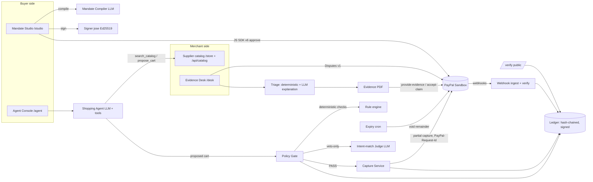
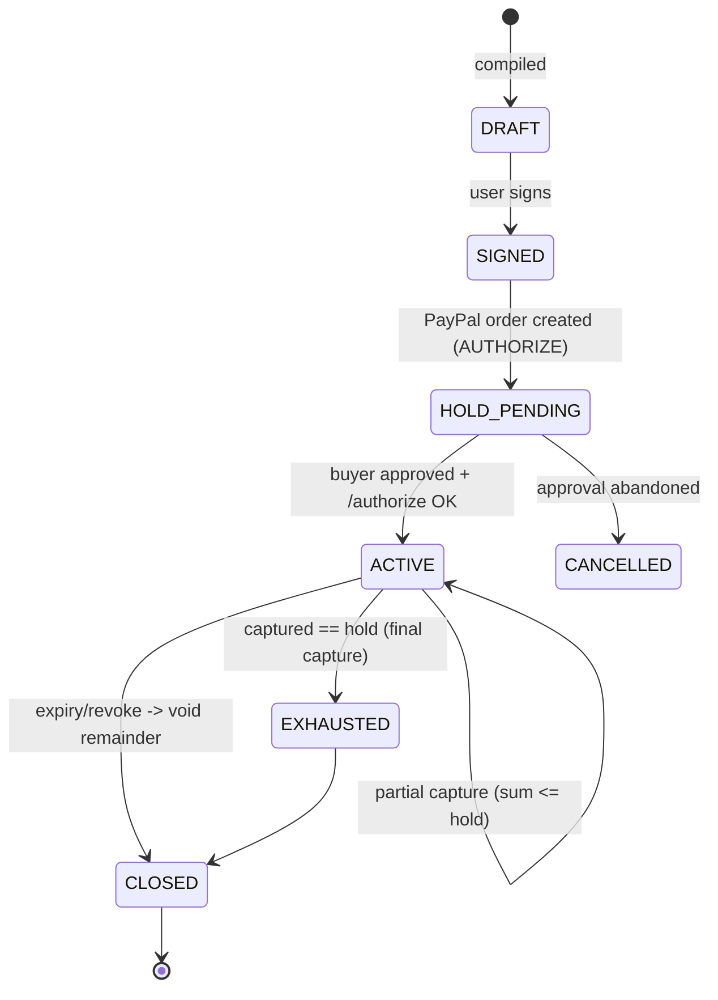

# Warrant — Architecture (v1)

One Next.js app (App Router) + Postgres, deployed on Render. Server-side only for anything touching
PayPal, signing keys, or the LLM. See ADRs in `adr/` for the reasoning behind each choice.

## Components

## The money state machine (mandate)

Rules: transitions happen only in `src/lib/mandates/state.ts`; every transition writes a ledger event in the
same DB transaction as the state change; PayPal calls happen before commit with idempotency keys so a retry
after a crash is safe.

## Capture path — the critical section
1. Agent calls `propose_cart(items)`. The agent signs the cart proposal with its agent key (light KYA).
2. Gate loads mandate (`SELECT ... FOR UPDATE` on the mandate row) and computes:
   - deterministic checks: merchant allowed, each SKU/category allowed, qty ≤ max, unit price ≤ ceiling,
     cart total ≤ remaining (= hold − Σ captures − Σ in-flight), now within validity window, step-up threshold.
   - any FAIL → BLOCK. All PASS → ask Judge.
3. Judge (LLM, structured output: `{verdict: MATCH|MISMATCH|SUSPICIOUS, reason}`) can only downgrade:
   MISMATCH → ESCALATE, SUSPICIOUS → BLOCK. Judge errors/timeouts → ESCALATE (fail closed to human).
4. PASS → insert `captures` row status `PENDING` with id `cap_<ulid>` (reserves the amount inside the
   transaction), commit; call `POST /v2/payments/authorizations/{id}/capture` with
   `PayPal-Request-Id: cap_<ulid>`, `amount`, `final_capture:false`, `invoice_id: cap_<ulid>`,
   `note_to_payer` referencing the mandate; on success update row `COMPLETED` + ledger event; on failure
   mark `FAILED` (releases reservation) + ledger event.
5. A DB CHECK/trigger guarantees Σ(PENDING+COMPLETED captures) ≤ hold amount per mandate.

## Dispute path
1. `CUSTOMER.DISPUTE.CREATED` webhook (verified) or periodic `GET /v1/customer/disputes` poll (fallback for sandbox latency).
2. Resolve dispute → disputed transaction (capture ID) → `captures` row → cart → mandate → ledger slice.
3. Deterministic triage:
   - capture exists in ledger, chain intact, mandate signature valid, cart ⊆ mandate constraints, fulfillment
     record matches cart → **WITHIN_MANDATE** → provide-evidence.
   - fulfillment record ≠ cart (substitution/short-ship) → **MERCHANT_FAULT** → accept-claim (refund).
   - anything missing/invalid → **NEEDS_REVIEW** (human).
4. LLM writes the human-readable narrative and maps the buyer's claim text to the evidence (never decides).
5. Evidence PDF (pdf-lib) + `provide-evidence` multipart, or `accept-claim`. Both are ledger events.
6. In the demo, the sandbox-only settle/adjudicate call can show the final outcome.

## Data model (Drizzle, Postgres)
- `principals` (id, role: USER|AGENT|MERCHANT|SYSTEM, display_name, public_jwk)
- `mandates` (id `mdt_<ulid>`, user_id, agent_id, instruction_text, constraints jsonb, canonical_hash,
  user_signature (JWS), status, currency, hold_amount, valid_from, valid_until, step_up_threshold,
  paypal_order_id, paypal_authorization_id, created_at)
- `carts` (id `crt_<ulid>`, mandate_id, items jsonb, total, agent_signature, gate_decision, gate_checks jsonb,
  judge_verdict jsonb, approval jsonb nullable, created_at)
- `captures` (id `cap_<ulid>`, mandate_id, cart_id, amount, status PENDING|COMPLETED|FAILED|REFUNDED,
  paypal_capture_id, paypal_debug_id, created_at)
- `fulfillments` (id, capture_id, shipped_items jsonb) — demo merchant's shipping record (for MERCHANT_FAULT)
- `disputes` (id, paypal_dispute_id, capture_id, reason, buyer_message, status, triage, decision,
  evidence_pdf_url, outcome, timestamps)
- `ledger_events` (seq bigserial, mandate_id, type, payload jsonb, prev_hash, hash, signature, actor, created_at)
- `webhook_events` (paypal_event_id unique, type, verified bool, raw jsonb, processed_at) — dedupe

## Ledger
`hash_n = SHA-256( prev_hash_{n-1} || canonical_json(payload_n) )` per mandate chain (genesis prev_hash =
SHA-256(mandate_id)). `signature_n = Ed25519(system_key, hash_n)` (JWS detached). `/verify` recomputes all.
Canonical JSON = RFC 8785 (JCS) via a small vetted library.

## Security & safety
- Secrets server-only; `NEXT_PUBLIC_*` limited to PayPal client ID (and AG Grid license if required by the lib).
- All PayPal POSTs idempotent; webhooks verified and deduped.
- LLM inputs from the catalog are treated as untrusted data (wrapped/delimited); the agent has no money tools.
- Per-IP rate limit + `AI_MAX_CALLS_PER_RUN` + Anthropic spend cap (protect the hosted demo during judging).
- Demo roles via signed cookie, no real auth (document as limitation).

## Observability
- Structured logs (pino) with mandate/cart/capture IDs and PayPal `debug_id` on every PayPal error.
- `/api/health` checks DB + PayPal token fetch (cached) for the uptime monitor.

## Deployment (Render)
- Web service (non-sleeping instance), managed Postgres (non-expiring plan), cron job (expiry voids + nightly demo reset).
- Webhook URL = `https://<app>.onrender.com/api/webhooks/paypal` registered in the PayPal sandbox app.
